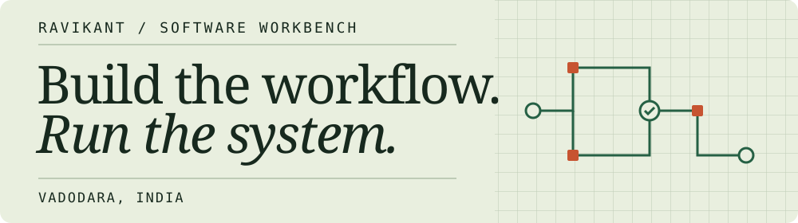

<picture>
  <source media="(prefers-color-scheme: dark)" srcset="./assets/workbench-dark.svg" />
  
</picture>

# Ravikant Upadhyay

I build **business apps, WordPress sites, and automation** in Vadodara, India. Much of my work starts with a manual process and ends with a tool a team can use and maintain.

[Portfolio](https://ravikant-1811.vercel.app/) · [LinkedIn](https://www.linkedin.com/in/ravikant-upadhyay) · [Email](mailto:nravikant123@gmail.com)

## Selected work

**[Taskflow](https://github.com/Ravikant-1811/Taskflow-PHP)** · PHP, SQLite 
A multi-tenant workspace for organizing tasks and tracking team progress.

**[Multi-User Platform](https://github.com/Ravikant-1811/Multi-User-PHP-Web-Application)** · PHP, MySQL 
Separate admin and client dashboards with role-based access and real-time chat.

**[Uphaaram](https://github.com/Ravikant-1811/uphaaram-website)** · React, Vite 
A storefront for handcrafted gifts and personalized hampers.

**[Vakify AI](https://github.com/Ravikant-1811/vakify-ai-2.0)** · React, TypeScript, Flask 
An AI-assisted learning app with coding labs, quizzes, and progress tracking.

**[SERP URL Harvester](https://github.com/Ravikant-1811/serp-url-harvester)** · Python 
Collects organic search-result URLs across a configurable page range for a keyword and location.

[Browse all repositories →](https://github.com/Ravikant-1811?tab=repositories)

## What I work with

**Applications:** PHP, JavaScript, TypeScript, Python, React, Next.js, MySQL, SQLite 
**Publishing:** WordPress, WooCommerce, Elementor, ACF 
**Operations:** Linux, Docker, PM2, Cloudflare, Vercel, GitHub Actions

## GitHub activity

<picture>
  <source media="(prefers-color-scheme: dark)" srcset="https://github-profile-summary-cards.vercel.app/api/cards/profile-details?username=Ravikant-1811&amp;theme=github_dark" />
  
</picture>

<picture>
  <source media="(prefers-color-scheme: dark)" srcset="https://github-profile-summary-cards.vercel.app/api/cards/stats?username=Ravikant-1811&amp;theme=github_dark" />
  
</picture>
<picture>
  <source media="(prefers-color-scheme: dark)" srcset="https://github-profile-summary-cards.vercel.app/api/cards/productive-time?username=Ravikant-1811&amp;theme=github_dark&amp;utcOffset=5.5" />
  
</picture>

<picture>
  <source media="(prefers-color-scheme: dark)" srcset="https://raw.githubusercontent.com/Ravikant-1811/Ravikant-1811/output/github-snake-dark.svg" />
  
</picture>
